# CommitmentLedger dApp (Workbench & Ledger Interface)

Web workbench and ledger interface for the [CommitmentLedger Intelligent Contract](https://github.com/huzyow155/commitment-ledger-genlayer) on GenLayer Studionet (Preview).

[](https://commitment-ledger-app-genlayer.vercel.app)
[](https://explorer-studio.genlayer.com/address/0xBaC90bbD20C3F9Ad873B602eC3684EF3145597DB)
[-amber.svg)](https://explorer-studio.genlayer.com)

**Production URL**: [https://commitment-ledger-app-genlayer.vercel.app](https://commitment-ledger-app-genlayer.vercel.app)

---

## What It Is

`CommitmentLedger` is an Intelligent Contract deployed on GenLayer Studionet (Preview) that records public promises and settles them against allowlisted public sources (Wikipedia, Reuters, AP, BBC, NASA, NOAA, ECB) via multi-validator consensus.

The contract holds no funds, requires no collateral or tokens, and accepts no caller-written evidence text. All resolutions are source-grounded: validators fetch the referenced web page, verify that it pertains to the subject, extract a verbatim quote (12+ characters), and classify the outcome (`KEPT`, `BROKEN`, `PARTIAL`).

This repository contains the front-end dApp:
1. **Interactive Notary Ledger (`/`)**: An educational landing page designed with warm editorial craftsmanship, detailing the two-phase consensus lifecycle, allowlist rules, and on-chain evidence cases.
2. **Interactive Workbench (`/app`)**: An operational workbench providing:
   - In-browser throwaway wallet generation (zero setup, zero faucet dependency).
   - Real-time client-side input validation mirroring contract constraints (including prospective vs retrospective deadline detection).
   - **Snapshot-diff ID discovery**: Automatically finds new commitment IDs even if transaction receipts do not return method return values.
   - **Multi-stage consensus pipeline monitor**: Tracks broadcast, validator execution, receipt status, and decodes contract revert payloads.
   - **On-chain reference examples**: Interactive lookup cards pre-loaded with verified Studionet transactions.
    - **Challenge & Dispute Modal**: Structured modal allowing participants to initiate bounded reconsideration re-reviews during the 600-second challenge window.

---

## Application Screenshots

Captured directly from the Vercel production deployment ([https://commitment-ledger-app-genlayer.vercel.app](https://commitment-ledger-app-genlayer.vercel.app)):

| Header & Brand Mark (Closed Menu) | Fullscreen Menu Drawer (Open) | Browser Tab & Vector Favicon |
| :---: | :---: | :---: |
|  | 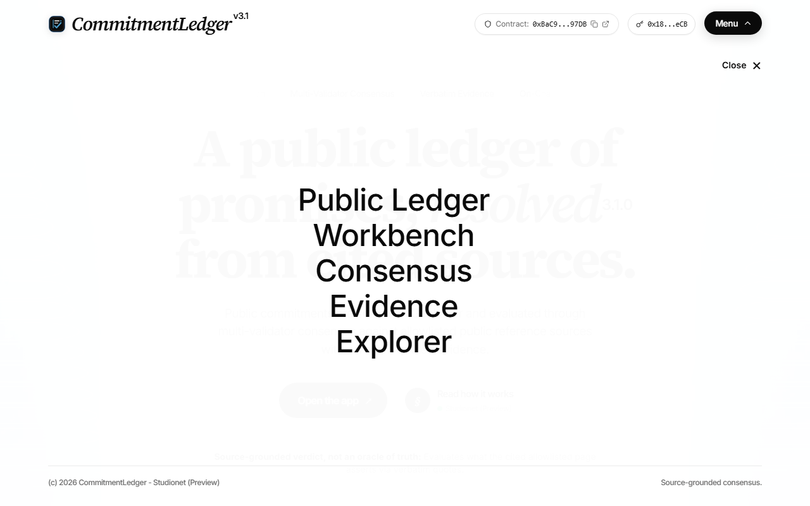 | 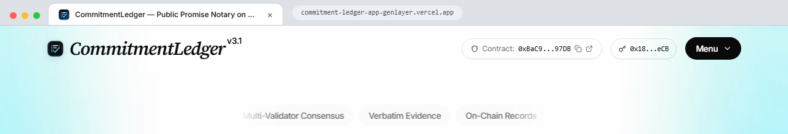 |

| Hero Serif Intro (Mid-Reveal) | Landing Overview (Settled) | Editorial Section (Architecture) |
| :---: | :---: | :---: |
| 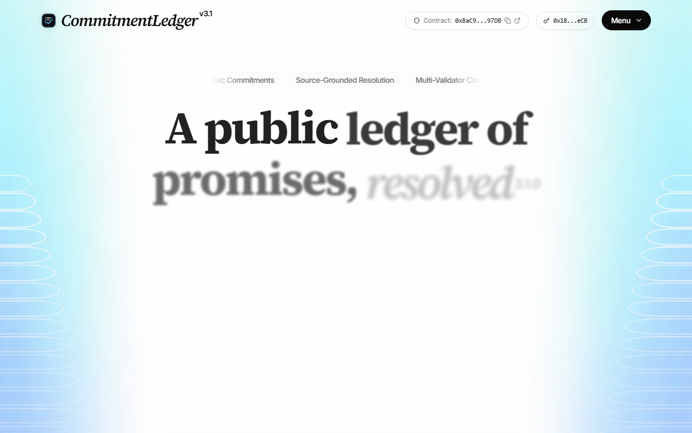 | 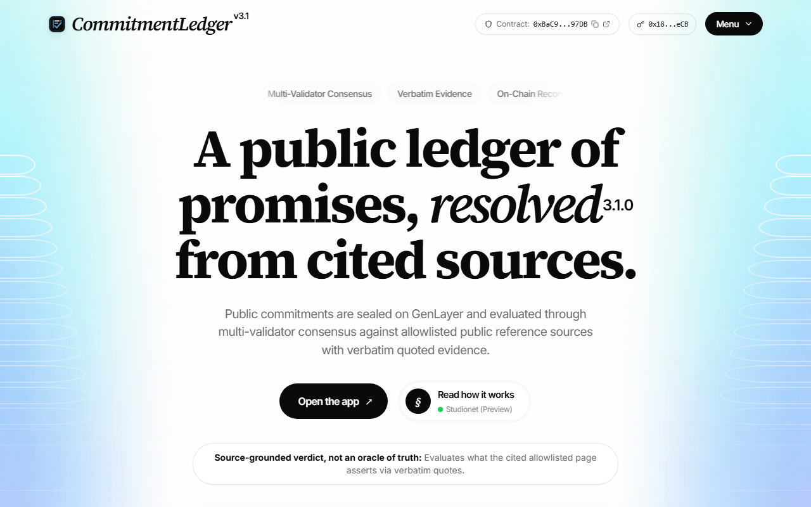 | 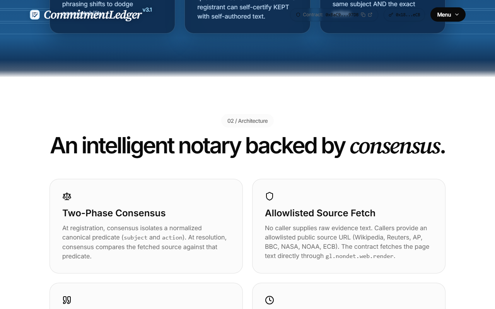 |

| Ocean Section (How Consensus Works) | Ocean Section (Verified Studionet Evidence) | Register Form & Client Validation |
| :---: | :---: | :---: |
| 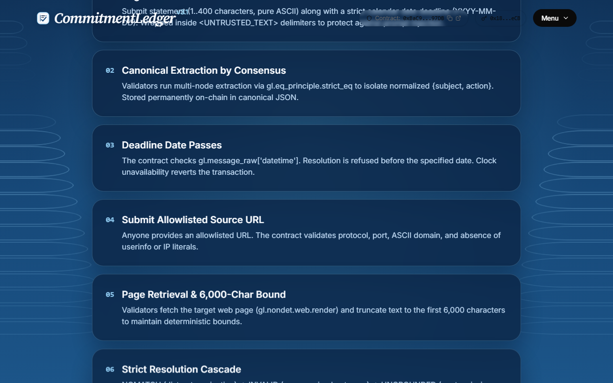 | 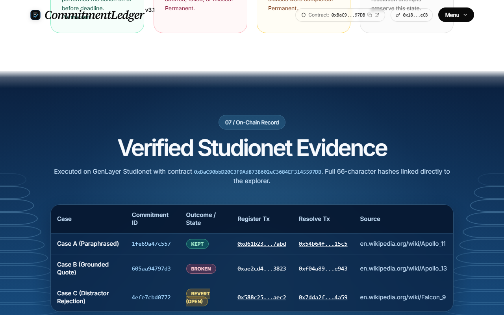 | 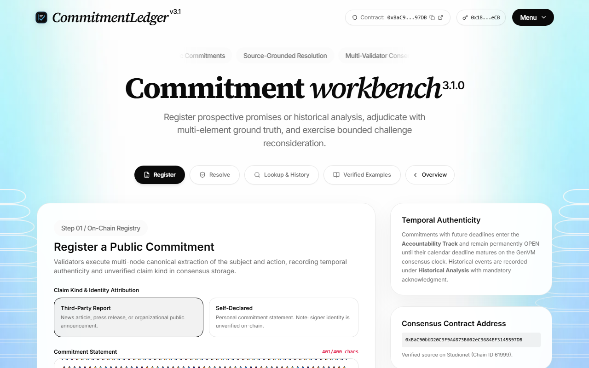 |

| Reference Examples Inspector | Mobile Landing (390px) | Mobile Workbench (390px) |
| :---: | :---: | :---: |
| 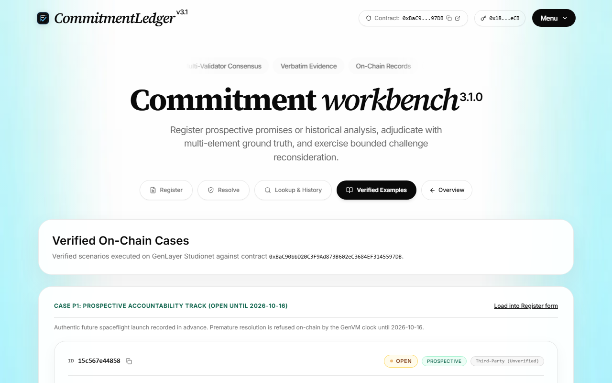 | 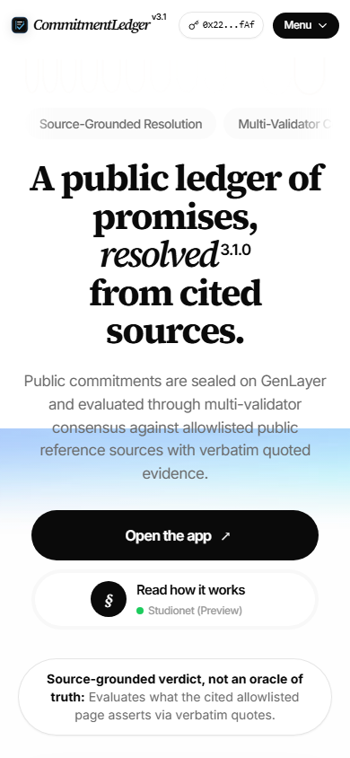 | 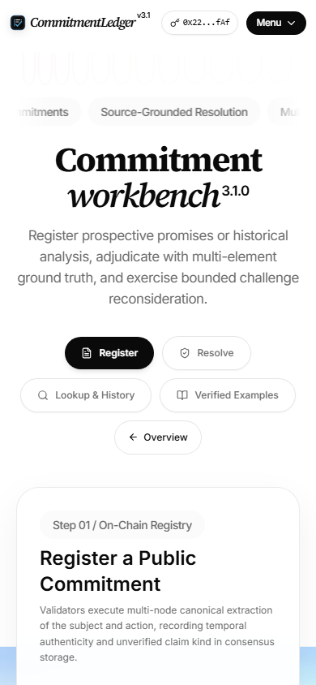 |

**Standalone Project Logo (for Portal submission)**: [`docs/logo/commitmentledger-logo.png`](docs/logo/commitmentledger-logo.png) (`1024x1024` transparent PNG) and [`public/logo.svg`](public/logo.svg) / [`public/logo-wordmark.svg`](public/logo-wordmark.svg).

---

## Verified On-Chain Evidence

The dApp connects directly to contract `0xBaC90bbD20C3F9Ad873B602eC3684EF3145597DB`. The following cases were executed and accepted by validators on GenLayer Studionet (Preview):

### Contract Verification Baseline

| Case | ID | Register Tx | Resolve Tx | Outcome | Source URL & Grounded Quote |
| :--- | :--- | :--- | :--- | :--- | :--- |
| **Case P1** (Prospective, OPEN) | `15c567e44858` | [`0xa2d9c6efc90cfddca01c61e437ce59623dcd757a88b3471f0d48d929389b232d`](https://explorer-studio.genlayer.com/tx/0xa2d9c6efc90cfddca01c61e437ce59623dcd757a88b3471f0d48d929389b232d) | None (Pending Maturity) | `null` (status `OPEN`) | `https://en.wikipedia.org/wiki/List_of_spaceflight_launches_in_October%E2%80%93December_2026`<br>Forward-looking commitment maturing 2026-10-16. |
| **Case A** (Paraphrased Source, KEPT) | `98e5aceacf75` | [`0xc95736b8b5a6256255d9b178d06d7ba419bd645af44118d8c0f38e5e98db2ca0`](https://explorer-studio.genlayer.com/tx/0xc95736b8b5a6256255d9b178d06d7ba419bd645af44118d8c0f38e5e98db2ca0) | [`0x03d0945985554655360388e96a8ec48c3aafb094b0b6248fdb7768d32d58a88c`](https://explorer-studio.genlayer.com/tx/0x03d0945985554655360388e96a8ec48c3aafb094b0b6248fdb7768d32d58a88c) | `KEPT` (status `FINAL`) | `https://en.wikipedia.org/wiki/Apollo_11`<br>Elements e1, e2 both `SATISFIED`. Evidence SHA-256 fingerprint verified. Marked `FINAL` via [`0x8b616611...`](https://explorer-studio.genlayer.com/tx/0x8b616611a308bb57bff06e6a49df4516b65f086b7f1a510c3a46b2088e8bb5ad). |
| **Case B** (Contradicted Action, BROKEN) | `cc4b8e0115bc` | [`0x5223bd845ce2db170af423ce1b240acf87814af9cf08d51194f3df1f61f6c018`](https://explorer-studio.genlayer.com/tx/0x5223bd845ce2db170af423ce1b240acf87814af9cf08d51194f3df1f61f6c018) | [`0x4e7bc3d81505717d857e4c619e161ff1ef916120ee4f836438010b28ed8e2947`](https://explorer-studio.genlayer.com/tx/0x4e7bc3d81505717d857e4c619e161ff1ef916120ee4f836438010b28ed8e2947) | `BROKEN` | `https://en.wikipedia.org/wiki/Apollo_13`<br>Action e1 marked `NOT_SATISFIED` due to oxygen tank explosion and mission abort. |
| **Case C** (Condition Omitted, BROKEN) | `8e8d07e65b36` | [`0x64f4447de40bcc867131e5178fbcff71d5273a8481cd7c29a78b420974b53b11`](https://explorer-studio.genlayer.com/tx/0x64f4447de40bcc867131e5178fbcff71d5273a8481cd7c29a78b420974b53b11) | [`0x997a8ae403c23fe702da3e1605386adad1398dc3ef99fefa9fff3473fa791fac`](https://explorer-studio.genlayer.com/tx/0x997a8ae403c23fe702da3e1605386adad1398dc3ef99fefa9fff3473fa791fac) | `BROKEN` | `https://en.wikipedia.org/wiki/Apollo_11`<br>Condition "all three astronauts" marked `NOT_SATISFIED` as Collins stayed in orbit. |
| **Case D** (Partial Fulfillment, PARTIAL) | `2b8d6befe470` | [`0xf9dfdb0101b0f5b9d33b3788229712a5db3ad0fcfb219bbdd799f979fe7b789e`](https://explorer-studio.genlayer.com/tx/0xf9dfdb0101b0f5b9d33b3788229712a5db3ad0fcfb219bbdd799f979fe7b789e) | [`0x912cf28959512c89781e571ebe9289c041768dbe96a83a035bb97d60d721303d`](https://explorer-studio.genlayer.com/tx/0x912cf28959512c89781e571ebe9289c041768dbe96a83a035bb97d60d721303d) | `PARTIAL` | `https://en.wikipedia.org/wiki/Apollo_11`<br>Elements e1, e2 SATISFIED; elements e3, e4 UNDETERMINED. |

### On-Chain Negative Rejection Tests

| Test | Submitted Parameter | Transaction Hash | Status Name | Leader Result | Revert Payload |
| :--- | :--- | :--- | :--- | :--- | :--- |
| Retrospective Without Ack | `1969-07-20` without ack | [`0x323c932da1eecdf57908b1784eb70c89ba7e21ba4864eb1f486948da63cb88d9`](https://explorer-studio.genlayer.com/tx/0x323c932da1eecdf57908b1784eb70c89ba7e21ba4864eb1f486948da63cb88d9) | `ACCEPTED` | `ERROR` | `"deadline is not after registration date; set retrospective_ack to record a historical claim"` |
| Invalid Claim Kind | `"UNOFFICIAL"` | [`0xddc18683e95ddae37b7ca8cf424fa7ae4da9435b6c9360822606566cb4b6b66c`](https://explorer-studio.genlayer.com/tx/0xddc18683e95ddae37b7ca8cf424fa7ae4da9435b6c9360822606566cb4b6b66c) | `ACCEPTED` | `ERROR` | `"claim_kind must be SELF_DECLARED or THIRD_PARTY_REPORT"` |
| Premature Resolution | `2099-01-01` before deadline | [`0x89fc1faebf98ec13efea9b3986a7ff779901f46b1c20c027e8006bf888497fae`](https://explorer-studio.genlayer.com/tx/0x89fc1faebf98ec13efea9b3986a7ff779901f46b1c20c027e8006bf888497fae) | `ACCEPTED` | `ERROR` | `"cannot resolve before deadline date"` |
| Distractor Source Rejection | Falcon 9 article for Apollo | [`0xdc86da7efb1d5c2254d39ecf1b8a5bba62ef1ec9fcbcfd5069929283e3518774`](https://explorer-studio.genlayer.com/tx/0xdc86da7efb1d5c2254d39ecf1b8a5bba62ef1ec9fcbcfd5069929283e3518774) | `ACCEPTED` | `ERROR` | `"source does not match this commitment"` |
| Non-Allowlisted Domain | `https://github.com/nasa/webb` | [`0xf6d53e22b3a6a0e1c4c4acbc17dcacfaadc6ea67d681510c6a012d50ca7251b3`](https://explorer-studio.genlayer.com/tx/0xf6d53e22b3a6a0e1c4c4acbc17dcacfaadc6ea67d681510c6a012d50ca7251b3) | `ACCEPTED` | `ERROR` | `"source_url domain not in authorized allowlist"` |
| Challenge While Open | Challenge on unadjudicated claim | [`0x78564fe06d644d673f3cff7efdb0df6a2a07d3fa8f01c2fae6fe0a37c598e3b4`](https://explorer-studio.genlayer.com/tx/0x78564fe06d644d673f3cff7efdb0df6a2a07d3fa8f01c2fae6fe0a37c598e3b4) | `ACCEPTED` | `ERROR` | `"commitment is not in provisional status"` |
| Finalize While Open | Finalize on unadjudicated claim | [`0x0f2ad28a478330777fa918b9911e3b5e408ec22e4eb1eebfe46e9df2ae8332c1`](https://explorer-studio.genlayer.com/tx/0x0f2ad28a478330777fa918b9911e3b5e408ec22e4eb1eebfe46e9df2ae8332c1) | `ACCEPTED` | `ERROR` | `"commitment is not in provisional status"` |
| Early Finalize (Window Open) | Finalize before 600s window expires | [`0x63e292dc46966d58aa7bba49fb28c7737a9e9744f697bebca688d90d3cc7480a`](https://explorer-studio.genlayer.com/tx/0x63e292dc46966d58aa7bba49fb28c7737a9e9744f697bebca688d90d3cc7480a) | `ACCEPTED` | `ERROR` | `"challenge window still open"` |

---

## Honest Scope & Limitations

1. **Studionet (Preview) Environment**:
   - The contract and dApp operate on GenLayer Studionet (Chain ID 61999). Validator execution times can range from 15 to 45 seconds per write transaction.
2. **Source-Grounded Verdict, Not Absolute Truth**:
   - The contract does not claim to be an infallible oracle of world events. It strictly assesses whether the provided public source URL supports the claim and contains verbatim grounding evidence.
3. **12,000-Character Source Window Boundary**:
   - When resolving, validators deterministically select keyword-relevant windows up to 12,000 characters from allowlisted web pages to remain within LLM context bounds and ensure deterministic consensus.
4. **On-Chain vs Unit-Tested Branches**:
   - **On-Chain Verified**: Prospective vs retrospective classification, claim kind declarations, element-based conjunction adjudication, distractor rejection, non-allowlist rejection, and the challenge & dispute state machine.
   - **Unit-Tested Only**: Boundary cases such as max decisions cap (3), malformed JSON parsing from adversarial models, and sentence segmentations are verified via Python unit tests in the contract repository.

---

## System Architecture

```text
+---------------------------------------------------------------------------------------+
|                                COMMITMENTLEDGER DAPP                                  |
+---------------------------------------------------------------------------------------+
|  User Browser (/app Workbench)                                                        |
|    │                                                                                  |
|    ├── Client-Side Preflight Checks (src/lib/validators.ts)                            |
|    │     ├── Character bounds (1 <= raw_text <= 400)                                  |
|    │     ├── Calendar date check & prospective vs retrospective deadline detection     |
|    │     └── Allowlist URL parsing (https only, no userinfo, port 443, 7 domains)     |
|    │                                                                                  |
|    ├── Throwaway Wallet (src/context/WalletContext.tsx)                               |
|    │     └── Ephemeral privateKey in localStorage, zero faucet funds required         |
|    │                                                                                  |
|    └── Transaction Pipeline Monitor (src/components/TxPipelineModal.tsx)              |
|          ├── Broadcast -> Poll transaction status via JSON-RPC                        |
|          ├── Leader Receipt Extraction -> Status code & decoded revert payload         |
|          └── Snapshot-Diff Discovery: Diff list_commitments_by_registrant before/after|
+---------------------------------------------------------------------------------------+
                                        │
                                        ▼ HTTPS JSON-RPC (https://studio.genlayer.com/api)
+---------------------------------------------------------------------------------------+
|                                GENLAYER STUDIONET                                     |
+---------------------------------------------------------------------------------------+
|  Intelligent Contract: 0xBaC90bbD20C3F9Ad873B602eC3684EF3145597DB (v3.1.0)            |
|    │                                                                                  |
|    ├── register_commitment(raw_text, deadline_hint, claim_kind, retrospective_ack)    |
|    │     └── Temporal check: PROSPECTIVE vs RETROSPECTIVE -> Stores as OPEN           |
|    │                                                                                  |
|    ├── submit_resolution(commitment_id, source_url)                                   |
|    │     ├── Window selection & segmentation -> sha256 evidence fingerprint          |
|    │     ├── Element-based evaluation -> Conjunction rule                             |
|    │     └── Sets status PROVISIONAL with 600s challenge window                       |
|    │                                                                                  |
|    ├── challenge_resolution(commitment_id, reason_code, rationale, countervailing_url)|
|    │     └── Reconsideration under strict grounding -> WITHDRAWN if ungrounded        |
|    │                                                                                  |
|    └── finalize_resolution(commitment_id)                                             |
|          └── Closes window -> Sets status "FINAL"                                     |
+---------------------------------------------------------------------------------------+
```

---

## Repository Structure

```text
commitment-ledger-app-genlayer/
├── contracts-reference/
│   └── CommitmentLedger.py       # Byte-identical reference copy of deployed contract
├── docs/
│   ├── ARCHITECTURE.md           # Consensus integration & frontend architecture
│   ├── TESTING.md                # Comprehensive test plan & audit checklist
│   ├── E2E_EVIDENCE.json         # Raw on-chain execution trace on Studionet
│   ├── logo/
│   │   └── commitmentledger-logo.png # Standalone 1024x1024 transparent PNG logo for Portal submission
│   └── screens/                  # Production screenshots from Vercel deployment
├── public/
│   ├── logo.svg                  # Master standalone vector mark
│   ├── logo-wordmark.svg         # Mark + CommitmentLedger v3.0 lockup
│   ├── favicon.svg               # Vector favicon
│   ├── favicon-32x32.png         # 32x32 PNG favicon
│   └── apple-touch-icon.png      # 180x180 Apple touch icon
├── scripts/
│   ├── check_address_consistency.mjs # Verifies contract address across codebase
│   ├── run_e2e.mjs               # On-chain test suite on GenLayer Studionet
│   ├── scan_ascii.mjs            # Pure ASCII code scanner
│   ├── scan_banned.mjs           # Zero-tolerance banned word auditor
│   ├── scan_secrets.mjs          # Secret & private key leak prevention scanner
│   └── verify_bundle.mjs         # Production dist/ bundle analyzer
├── src/
│   ├── config/chain.ts           # Chain constants, contract address, allowlist
│   ├── context/WalletContext.tsx # Throwaway wallet session management
│   ├── lib/
│   │   ├── outcome.ts            # Exact-token parser for status & outcome
│   │   ├── revertMap.ts          # Human-friendly decoding for contract reverts
│   │   └── validators.ts         # Client-side input validation logic
│   ├── services/
│   │   └── contractService.ts    # JSON-RPC reads, transactions, snapshot-diff
│   ├── components/
│   │   ├── CommitmentCard.tsx    # Stamp-inspired commitment details card
│   │   ├── Header.tsx            # Navigation, network status, wallet actions
│   │   └── TxPipelineModal.tsx   # Multi-stage transaction pipeline tracker
│   ├── pages/
│   │   ├── Landing.tsx           # Educational landing page
│   │   └── Workbench.tsx         # Operational /app workbench
│   ├── App.tsx                   # Hash-based view router
│   └── main.tsx                  # Application entry point
├── tests/
│   ├── ui_production.mjs         # Playwright production UI test suite
│   └── validators.test.ts        # Vitest client-side validation test suite
└── package.json
```

---

## Contract Reference Verification

The file `contracts-reference/CommitmentLedger.py` is byte-identical to the contract deployed on Studionet:

- **Expected SHA-256**: `9380175f322387696259a522483239be209d58b8e21fd4928cadf4ab46702e0e`
- **Verification Command**:
  ```bash
  node -e "const crypto = require('crypto'), fs = require('fs'); const hash = crypto.createHash('sha256').update(fs.readFileSync('contracts-reference/CommitmentLedger.py')).digest('hex'); console.log('SHA-256:', hash); process.exit(hash === '9380175f322387696259a522483239be209d58b8e21fd4928cadf4ab46702e0e' ? 0 : 1);"
  ```

---

## Superseded Deployments

The following contracts were deployed during development and have been superseded:

| Address | Deploy Transaction Hash | Superseded Reason |
| :--- | :--- | :--- |
| `0xdD0d120B50ED65400E8b6a060bB15103B42544E8` | [`0x9ddb3a96c40d222c8e4ac1b781029a3b6c33937796aa1348a060f4ea9ba14467`](https://explorer-studio.genlayer.com/tx/0x9ddb3a96c40d222c8e4ac1b781029a3b6c33937796aa1348a060f4ea9ba14467) | Superseded by v3.1.0: aligned fingerprinting across network nodes and standardized status naming. |
| `0x3155c7c80f4334968d61E1b79f74EB864CF7cb08` | [`0x1aff7096cb2283f0e60ea74f4249d5d319f650177d9bee7a8ae798b7cf4c970a`](https://explorer-studio.genlayer.com/tx/0x1aff7096cb2283f0e60ea74f4249d5d319f650177d9bee7a8ae798b7cf4c970a) | Superseded by v3.0.0: answered steward review with temporal authenticity, element-based adjudication of full original statement, claim kind/identity unverified, bounded challenge & reconsideration state machine, and sha256 evidence fingerprints. |
| `0x0A4Dc27c06520EA1EbcAEAFBF94f90b2AbDc6aa1` | [`0x9b738652bceac390143a01f7dcf7ca24b7a92714430d950c34f9ae2936de4f52`](https://explorer-studio.genlayer.com/tx/0x9b738652bceac390143a01f7dcf7ca24b7a92714430d950c34f9ae2936de4f52) | Superseded by v2.2.0: could write PARTIAL when model returned no valid outcome. |
| `0x8a5269aa724E77D799b3F0dbbaeee7683157f52d` | [`0xc8461e53602c7cc610eab8d99bb8f277b388debb1366736529f90439ba8e4a6b`](https://explorer-studio.genlayer.com/tx/0xc8461e53602c7cc610eab8d99bb8f277b388debb1366736529f90439ba8e4a6b) | Superseded by v2.1.0: removed ungrounded fallback and enforced mandatory calendar date deadlines. |
| `0x13b20E2DBc4E8C2D30e3E484D78ee90f583882F3` | [`0x50015b28539130d6bebb768639427029725183f3b8b6b8b4490510c68ccfc235`](https://explorer-studio.genlayer.com/tx/0x50015b28539130d6bebb768639427029725183f3b8b6b8b4490510c68ccfc235) | Initial caller-written text prototype, superseded by source-based resolution. |

---

## Local Development & Testing

### Prerequisites

- Node.js >= 18
- npm >= 9

### Getting Started

```bash
# Clone the repository
git clone https://github.com/huzyow155/commitment-ledger-app-genlayer.git
cd commitment-ledger-app-genlayer

# Install dependencies
npm install

# Start local development server
npm run dev
```

### Running Test & Verification Suites

```bash
# Run unit tests (Vitest)
npm test

# Run full project checks (Unit tests + ASCII + Banned Words + Secrets + Address consistency)
npm run check

# Build production bundle and verify absence of superseded contract addresses
npm run build
node scripts/verify_bundle.mjs

# Run production UI tests against Vercel deployment (Playwright)
node tests/ui_production.mjs
```

---

## Related Repositories

- **Contract Repository**: [https://github.com/huzyow155/commitment-ledger-genlayer](https://github.com/huzyow155/commitment-ledger-genlayer)
  - Contains the Python Intelligent Contract source, deploy scripts, unit tests, and the historical superseded deployments table (v1.0.0, v2.0.0, v2.1.0, v2.2.0).
- **GenLayer Studionet Explorer**: [https://explorer-studio.genlayer.com](https://explorer-studio.genlayer.com)
